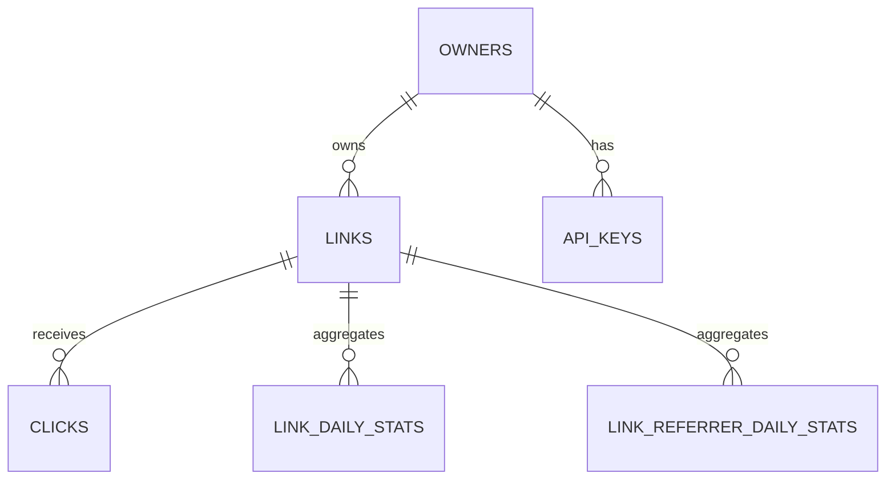

# Data Model

Primary store: SQLite 3.38+ (Ubuntu 24.04 ships 3.45) with WAL mode.
Cache and rate limits: Redis. Analytics rollups: SQLite at Tier 1; columnar store at Tier 2.

## 1. SQLite configuration

Persistent (set once):

```sql
PRAGMA journal_mode = WAL;
PRAGMA auto_vacuum = INCREMENTAL;
```

Per connection (must be set by the app on every connect):

```sql
PRAGMA foreign_keys = ON;
PRAGMA busy_timeout = 5000;
PRAGMA synchronous = NORMAL;
PRAGMA wal_autocheckpoint = 1000;
PRAGMA journal_size_limit = 67108864;
PRAGMA temp_store = MEMORY;
PRAGMA mmap_size = 268435456;
```

Notes:

- WAL allows one writer and many readers. Tier 1 peak writes (~2/s) are far below the limit.
- `synchronous=NORMAL` can lose the last transactions on OS/power loss; Litestream replication keeps RPO under ~10s.
- Keep write transactions short; never perform network I/O while holding one.
- `auto_vacuum=INCREMENTAL` must be set before tables are created. Run `PRAGMA incremental_vacuum` from the cleanup job; a full `VACUUM` requires downtime.
- Monitor WAL size; a long-lived reader can prevent checkpointing.

## 2. Entity relationship



## 3. Schema

Timestamps are Unix epoch seconds (`INTEGER`, UTC). Conversion happens at the API boundary. UUID values are generated by the application (`uuid4().hex`).

### owners

| Column | Type | Notes |
| --- | --- | --- |
| `id` | `TEXT` PK | UUID hex |
| `email` | `TEXT` unique | Nullable in single-key v1 |
| `created_at` | `INTEGER` | Default `unixepoch()` |

### api_keys

| Column | Type | Notes |
| --- | --- | --- |
| `id` | `TEXT` PK | UUID hex |
| `owner_id` | `TEXT` FK → owners | `ON DELETE CASCADE` |
| `key_hash` | `BLOB` unique | SHA-256 of key; never store plaintext |
| `created_at` | `INTEGER` | |
| `last_used_at` | `INTEGER` | |
| `revoked_at` | `INTEGER` | |

### links

```sql
CREATE TABLE links (
  id          INTEGER PRIMARY KEY,
  code        TEXT    NOT NULL UNIQUE,
  long_url    TEXT    NOT NULL,
  owner_id    TEXT    REFERENCES owners(id) ON DELETE SET NULL,
  status      TEXT    NOT NULL DEFAULT 'active',
  created_at  INTEGER NOT NULL DEFAULT (unixepoch()),
  updated_at  INTEGER NOT NULL DEFAULT (unixepoch()),
  expires_at  INTEGER,
  deleted_at  INTEGER,
  CHECK (length(code) BETWEEN 3 AND 30),
  CHECK (code NOT GLOB '*[^0-9A-Za-z_-]*'),
  CHECK (length(long_url) BETWEEN 1 AND 2048),
  CHECK (status IN ('active', 'blocked', 'deleted'))
);

CREATE INDEX links_owner_created_idx ON links (owner_id, created_at DESC);
CREATE INDEX links_expiry_idx ON links (expires_at)
  WHERE status = 'active' AND expires_at IS NOT NULL;
```

Notes:

- `code` is unique case-sensitively. Generated codes are 7 base62 chars; custom aliases are lowercased before insert and limited to 3–30 chars.
- `status` and `deleted_at` are intentionally redundant: status drives hot-path checks, `deleted_at` supports audit.
- The partial expiry index keeps cleanup scans small.
- SQLite has no native `citext`; normalize email to lowercase in the application.

### clicks (raw, short retention)

```sql
CREATE TABLE clicks (
  id         INTEGER PRIMARY KEY,
  link_id    INTEGER NOT NULL REFERENCES links(id) ON DELETE CASCADE,
  clicked_at INTEGER NOT NULL,
  ip_hash    BLOB,
  user_agent TEXT,
  referrer   TEXT,
  country    TEXT
);

CREATE INDEX clicks_link_time_idx ON clicks (link_id, clicked_at DESC);
CREATE INDEX clicks_time_idx ON clicks (clicked_at);
```

Raw clicks are retained for 7 days, then deleted in batches. Daily rollups are the durable analytics source.

### link_daily_stats

```sql
CREATE TABLE link_daily_stats (
  link_id    INTEGER NOT NULL REFERENCES links(id) ON DELETE CASCADE,
  day        TEXT    NOT NULL,
  clicks     INTEGER NOT NULL DEFAULT 0,
  unique_hll BLOB,
  PRIMARY KEY (link_id, day)
);
```

- `day` is `YYYY-MM-DD` (UTC).
- Rollups are idempotent (`INSERT ... ON CONFLICT ... DO UPDATE`) so workers can replay.
- `unique_hll` stores a HyperLogLog sketch (~2% error) for approximate unique visitors.

### link_referrer_daily_stats

```sql
CREATE TABLE link_referrer_daily_stats (
  link_id  INTEGER NOT NULL REFERENCES links(id) ON DELETE CASCADE,
  day      TEXT    NOT NULL,
  referrer TEXT    NOT NULL,
  clicks   INTEGER NOT NULL DEFAULT 0,
  PRIMARY KEY (link_id, day, referrer)
);
```

- Stores top-N referrers per link per day; normalize empty referrers to `(direct)`.
- Keeps `top_referrers` queries cheap without retaining 30 days of raw clicks.
- Rollups use the same idempotent upsert pattern.

## 4. Access patterns → indexes

| Query | Index |
| --- | --- |
| Redirect by code | `links.code` unique index |
| List owner links | `links_owner_created_idx` |
| Find links due for expiry cleanup | `links_expiry_idx` |
| Click series for a link | `clicks_link_time_idx` |
| Daily stats | `link_daily_stats` primary key |
| Top referrers | `link_referrer_daily_stats` primary key |
| Prune old raw clicks | `clicks_time_idx` |

## 5. Redis keys

| Key | Value | TTL |
| --- | --- | --- |
| `link:{code}` | JSON `{link_id, long_url, status, expires_at}` | 1h + jitter |
| `link:miss:{code}` | `1` | 30–60s |
| `ratelimit:{scope}:{id}` | counter; `id` is a hashed API key or salted IP | window |
| `events:clicks` | Redis Stream of click events | trimmed by length |

Redis is disposable. Disable persistence (`--save "" --appendonly no`); a restart only causes a cold cache. During a Redis outage, cache writes and invalidation are skipped: redirects fall back to SQLite, but a link deleted during the outage may remain stale in Redis until its TTL expires. A future cache-generation scheme should remove that window.

## 6. Retention

| Data | Retention |
| --- | --- |
| Links | Until deleted; expired/deleted rows kept 30 days for audit/tombstone |
| Raw clicks | 7 days |
| Daily stats | 13 months |
| Referrer daily stats | 13 months |
| API keys | Until revoked |
| Redis | TTL-driven, no backups |

## 7. Migrations

- Alembic with `render_as_batch=True` (SQLite has limited `ALTER TABLE`).
- Forward-only, one logical change per revision.
- Additive first: add nullable column → backfill in batches → enforce constraint.
- Back up before every migration: `sqlite3 data/app.db ".backup 'data/pre-migrate-$(date +%F-%H%M).db'"`.
- Every migration must be compatible with the previous app version for one release (expand/contract).
- Test migrations against a copy of a production-like database, not only an empty one.

## 8. Moving to Postgres (Tier 2)

Keep the domain layer free of SQLite-specific SQL. When triggers in [ADR-0002](adr/0002-primary-datastore.md) are met:

1. Add Postgres to CI and run the same integration suite against both engines.
2. Dual-write or use a short maintenance window to migrate data.
3. Switch the repository layer via configuration.
4. Keep SQLite as a local development option if desired.
