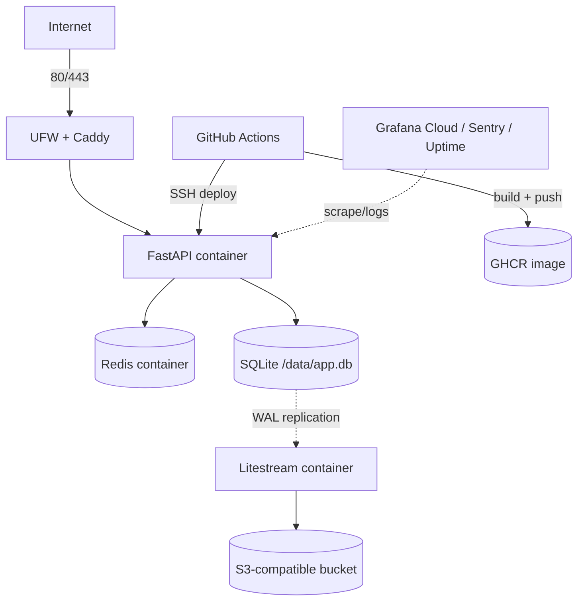

# Deployment Plan (Production-Like, Single Node)

## 1. Intent

Run the URL shortener the way a small production service runs: TLS, a reverse proxy, immutable images, CI/CD, continuous database replication, monitoring, alerting, backups, and runbooks.

The target is a **single-node, production-like** deployment — not a highly available cluster. HA and multi-region are Tier 2 exercises (see [system design](system-design.md)).

## 2. Recommended baseline

| Item | Choice | Why |
| --- | --- | --- |
| Provider | Hetzner Cloud CX22 (or DigitalOcean 2GB) | Cheap, reliable SSD, EU/US regions |
| Spec | 2 vCPU, 4GB RAM, 40GB SSD | API + Redis + backups + headroom |
| OS | Ubuntu 24.04 LTS | Long support, current SQLite |
| Runtime | Docker Engine + Compose plugin | Reproducible deploys; easy rollback |
| Proxy | Caddy 2 | Automatic HTTPS, HTTP/3, simple config |
| App | FastAPI + Uvicorn, 2 workers | Python stack; SQLite-friendly |
| DB | SQLite 3.45+ on local SSD, WAL | Simple, fast reads; adequate Tier 1 writes |
| Cache | Redis 7, no persistence, 256MB cap | Cache and rate limits are disposable |
| Backups | Litestream → Backblaze B2 / Cloudflare R2 | Continuous WAL replication, low cost |
| CI/CD | GitHub Actions → GHCR → SSH deploy | Standard, auditable |
| Monitoring | Grafana Cloud free + Sentry + UptimeRobot | Low-ops observability |
| Domain | `s.example.com` (replace with yours) | Short hostname; Caddy handles TLS |

Estimated cost: **$6–10/month** (VPS ~$5, object storage ~$0.10, domain ~$1 amortized, free monitoring tiers).

## 3. Topology



Public ports: 22 (SSH, ideally restricted), 80, 443. Redis and the API port are never published.

## 4. Server setup (one-time)

1. Create the VPS in a region near users; add your SSH key; enable IPv6 if available.
2. DNS: `A` record (and `AAAA` if used) for `s.example.com` → server IP, TTL 300.
3. Harden the host:
   - Ubuntu updates + `unattended-upgrades`
   - SSH key-only auth; disable password and root login
   - `ufw default deny incoming`; allow 22/80/443
   - `fail2ban` for SSH
   - 2GB swap file
   - `systemd-timesyncd` enabled; timezone UTC
   - non-root `deploy` user in the `docker` group
4. Install Docker Engine + Compose plugin from the official repo.
5. Create `/opt/url-shortener/` owned by `deploy`; place `compose.yml`, `Caddyfile`, `litestream.yml`, `.env.production` (mode 600).
6. Create the object-storage bucket and a scoped access key (read/write only that prefix).

## 5. Runtime layout

```text
/opt/url-shortener/
  compose.yml
  Caddyfile
  litestream.yml
  .env.production        # 600, deploy:deploy
  data/                  # app.db, app.db-wal, snapshots
```

Compose services:

| Service | Image | Restart | Notes |
| --- | --- | --- | --- |
| `caddy` | `caddy:2-alpine` | unless-stopped | 80/443, volumes for certs |
| `api` | `ghcr.io/OWNER/url-shortener:TAG` | unless-stopped | non-root, healthcheck, no published port |
| `redis` | `redis:7-alpine` | unless-stopped | no persistence, 256MB, internal network |
| `litestream` | `litestream/litestream:<pinned>` | unless-stopped | reads `/data`, writes to bucket |

Compose sketch:

```yaml
services:
  caddy:
    image: caddy:2-alpine
    ports: ["80:80", "443:443"]
    volumes:
      - ./Caddyfile:/etc/caddy/Caddyfile:ro
      - caddy_data:/data
      - caddy_config:/config
    depends_on: [api]
    restart: unless-stopped

  api:
    image: ghcr.io/OWNER/url-shortener:${TAG:-latest}
    env_file: .env.production
    volumes:
      - ./data:/data
    expose: ["8000"]
    depends_on: [redis]
    restart: unless-stopped
    security_opt: ["no-new-privileges:true"]
    deploy:
      resources:
        limits:
          cpus: "1.5"
          memory: 1g
    healthcheck:
      test: ["CMD", "python", "-c", "import urllib.request; urllib.request.urlopen('http://127.0.0.1:8000/healthz')"]
      interval: 30s
      timeout: 3s
      retries: 3

  redis:
    image: redis:7-alpine
    command:
      - redis-server
      - --save
      - ""
      - --appendonly
      - "no"
      - --maxmemory
      - 256mb
      - --maxmemory-policy
      - allkeys-lru
    expose: ["6379"]
    restart: unless-stopped

  litestream:
    image: litestream/litestream:latest   # pin a tested version before go-live
    command: ["replicate"]
    volumes:
      - ./data:/data
      - ./litestream.yml:/etc/litestream.yml:ro
    env_file: .env.production
    depends_on: [api]
    restart: unless-stopped

volumes:
  caddy_data:
  caddy_config:
```

Notes:

- The API container runs as a non-root UID that owns `./data`.
- SQLite lives on the host SSD via a bind mount, never on a network filesystem.
- Never scale the API to multiple hosts with the same SQLite file.

## 6. SQLite in production

Persistent settings (set once):

```sql
PRAGMA journal_mode = WAL;
PRAGMA auto_vacuum = INCREMENTAL;
```

Apply on every connection (SQLAlchemy `connect` event):

```sql
PRAGMA foreign_keys = ON;
PRAGMA busy_timeout = 5000;
PRAGMA synchronous = NORMAL;
PRAGMA wal_autocheckpoint = 1000;
PRAGMA journal_size_limit = 67108864;
PRAGMA temp_store = MEMORY;
PRAGMA mmap_size = 268435456;
```

Rules:

- One writer is fine: peak writes are ~2/s at Tier 1.
- Keep transactions short; no network calls or analytics inside a transaction.
- Retry `SQLITE_BUSY` with backoff; batch cleanup/rollups and run them off-peak.
- Use `PRAGMA incremental_vacuum` during maintenance; a full `VACUUM` needs downtime.
- Keep the DB and WAL on local SSD; monitor free space (WAL can grow during long readers).
- Back up before every migration (`sqlite3 .backup`), even with Litestream.

## 7. Process model

- Uvicorn with 2 workers: `--workers 2 --proxy-headers --forwarded-allow-ips=*`.
- Sync SQLAlchemy sessions with short scopes; FastAPI runs sync endpoints in a threadpool.
- Keep the app stateless except for SQLite; sessions/counters live in Redis or the DB.
- Graceful shutdown: `--timeout-graceful-shutdown 20`.
- Container limits: `cpus: 1.5`, `mem_limit: 1g` for the API; leave headroom for Redis, Litestream, and the OS.

## 8. Reverse proxy and TLS

`Caddyfile`:

```caddyfile
s.example.com {
    encode zstd gzip

    header {
        Strict-Transport-Security "max-age=31536000; includeSubDomains"
        X-Content-Type-Options "nosniff"
        Referrer-Policy "no-referrer"
        -Server
    }

    @metrics path /metrics
    respond @metrics 404

    reverse_proxy api:8000

    log {
        output stdout
        format json
    }
}
```

- Caddy obtains and renews certificates automatically.
- HTTP redirects to HTTPS by default.
- Keep redirect responses `Cache-Control: no-store` in v1. Do not put a CDN in front of redirects until analytics and caching semantics are settled. If Cloudflare is added later, resolve the real client IP from `CF-Connecting-IP` for rate limiting and hashing.

## 9. Configuration and secrets

`.env.production` (mode 600):

```dotenv
APP_ENV=production
APP_BASE_URL=https://s.example.com
DATABASE_PATH=/data/app.db
REDIS_URL=redis://redis:6379/0
API_KEY_PEPPER=...
IP_HASH_SALT=...
SENTRY_DSN=...
LITESTREAM_ACCESS_KEY_ID=...
LITESTREAM_SECRET_ACCESS_KEY=...
```

Rules:

- Never commit `.env.production`; keep `.env.example` in the repo.
- Generate secrets with `openssl rand -hex 32`.
- Rotate `API_KEY_PEPPER` and `IP_HASH_SALT` only with a documented migration.
- The deploy user can read the file; containers receive values via `env_file`.

## 10. CI/CD

Pipeline (GitHub Actions):

1. **CI on PR:** `uv sync --frozen`, `ruff format --check`, `ruff check`, `mypy`, `pytest`, migration check on empty and seeded DBs, Docker build.
2. **Build on tag `v*`:** push `ghcr.io/OWNER/url-shortener:<sha>` and `:<tag>`.
3. **Deploy via SSH:**
   - `docker compose pull api`
   - back up SQLite (`sqlite3 .backup`)
   - run Alembic migrations as a one-shot container
   - `docker compose up -d --no-deps api`
   - poll `/readyz` for 60s
   - on failure: redeploy the previous tag and alert

Deploy script properties:

- Idempotent and safe to re-run.
- Migrations are backward-compatible with the previous app version (expand/contract).
- Previous image tags are retained for rollback.
- Never run `docker compose down -v` in production.

Downtime: a single-node restart has a 3–10s gap. Caddy can serve a static maintenance page during the gap. True zero-downtime (blue-green with two API containers sharing SQLite) is a Phase 6 stretch; both versions must be schema-compatible.

## 11. Environments

| Env | Where | Data | Purpose |
| --- | --- | --- | --- |
| Local | Docker Compose | `./data/dev.db` | Development and tests |
| Staging | Same VPS, separate compose project/port, or a small second VPS | `./staging/data/staging.db` | Migration and deploy rehearsal |
| Production | VPS | `./data/app.db` | Live traffic |

Staging uses separate buckets/prefixes and API keys. Never restore production data into staging without anonymizing IP hashes.

## 12. Observability and alerting

Metrics (Prometheus at `/metrics`; scrape `api:8000` internally and block `/metrics` at Caddy):

- `shortener_http_requests_total{method,route,status}` and `shortener_http_request_duration_seconds`
- `shortener_cache_operations_total{result}` for hit/miss/negative/error/skipped
- `shortener_redirects_total{outcome}`
- `shortener_analytics_stream_pending` and `shortener_analytics_stream_length`
- `shortener_sqlite_busy_total` for `database is locked` errors
- SQLite `SQLITE_BUSY` count, WAL size, DB file size (not yet instrumented)
- Litestream replication lag, last successful sync
- Process CPU/RAM, disk usage, load average

Metrics are in-process today. With 2 Uvicorn workers, enable `prometheus-client` multiprocess mode or scrape each worker separately.

Logs:

- JSON to stdout with `request_id`, method, path, status, duration; no full IPs or URLs containing secrets.
- Docker log rotation: `max-size: 10m`, `max-file: 3`.

Alerts (email/Slack/Discord):

| Alert | Threshold |
| --- | --- |
| 5xx rate | >1% for 5 min |
| Redirect p99 | >200ms for 5 min |
| Disk usage | >80% |
| Litestream lag | >60s |
| Ready check failing | 2 consecutive probes |
| TLS expiry | <14 days (Caddy renews; alert if renewal fails) |

Uptime: external probe on `GET /healthz` and a known redirect every minute.
Errors: Sentry with release tags matching image tags.

## 13. Backups and disaster recovery

**Continuous:** Litestream replicates WAL frames to object storage; target RPO <10s.

`litestream.yml`:

```yaml
dbs:
  - path: /data/app.db
    replicas:
      - type: s3
        bucket: YOUR_BUCKET
        path: prod
        endpoint: https://s3.us-west-004.backblazeb2.com
        region: us-west-004
        access-key-id: ${LITESTREAM_ACCESS_KEY_ID}
        secret-access-key: ${LITESTREAM_SECRET_ACCESS_KEY}
```

**Nightly snapshot:** `sqlite3 .backup` to a dated file, upload it to the bucket, and retain 30 daily + 12 monthly.

**Restore drill (monthly):**

1. Stop the API and Litestream.
2. `docker compose run --rm --entrypoint litestream litestream restore -o /data/app.db s3://BUCKET/prod`
3. Start Litestream, then the API; verify `/readyz`, a known code redirects, and counts match expectations.
4. Record RTO in the learning log.

**Total host loss:**

1. Create a new VPS and run host setup.
2. Clone repo/deploy files; restore `.env.production` from the secret manager.
3. Restore SQLite from Litestream.
4. `docker compose up -d`; point DNS at the new IP (TTL 300 → ~5 min propagation).
5. Verify and re-enable alerts.

Target RTO: <30 minutes with DNS and secrets available.

## 14. Security checklist

- [ ] SSH key-only; root login disabled; fail2ban enabled
- [ ] UFW denies all but 22/80/443
- [ ] Containers run non-root; `no-new-privileges`
- [ ] Redis and API ports not published
- [ ] Secrets in a 600 file, not in git or image layers
- [ ] API keys stored hashed; IPs stored salted-hashed
- [ ] App rate limits + request size limits
- [ ] `pip-audit`/Dependabot and image scan in CI
- [ ] Automatic OS security updates
- [ ] HSTS and security headers at Caddy
- [ ] Backups encrypted at rest; bucket credentials scoped
- [ ] Restore and rollback rehearsed

## 15. Go-live checklist

- [ ] Staging deploy + migration rehearsal passed
- [ ] Load test at 2× Tier 1 peak (400 RPS redirects) passed
- [ ] Backups running; restore drill completed
- [ ] Alerts routed and tested
- [ ] DNS and TLS verified (HTTP→HTTPS, HSTS)
- [ ] Runbooks accessible to on-call
- [ ] Previous image tag and rollback command documented
- [ ] Cost alerts/budget set

## 16. Runbooks

**Deploy**

```bash
cd /opt/url-shortener
docker compose pull api
sqlite3 data/app.db ".backup 'data/backup-$(date +%F-%H%M).db'"
docker compose run --rm --no-deps --entrypoint alembic api upgrade head
docker compose up -d --no-deps api
for i in $(seq 1 30); do curl -fsS https://s.example.com/readyz && break; sleep 2; done
```

**Rollback**

```bash
TAG=<previous-tag> docker compose up -d --no-deps api
```

Migrations must be backward-compatible. If not, restore the pre-deploy backup during a maintenance window.

**Restore**

```bash
docker compose stop api litestream
docker compose run --rm --entrypoint litestream litestream restore -o /data/app.db s3://BUCKET/prod
docker compose start litestream
docker compose start api
curl -fsS https://s.example.com/readyz
```

**Disk full**

1. Check `df -h` and `du -sh data/*`.
2. Rotate/delete old container logs and snapshots.
3. Run `PRAGMA wal_checkpoint(TRUNCATE)` if safe, or restart the API to release readers.
4. Resize the volume; add a disk-usage alert follow-up.

**SQLite busy**

1. Check API logs for `SQLITE_BUSY` spikes and the slow query.
2. Ensure analytics jobs do not overlap with write bursts.
3. Increase `busy_timeout` temporarily; move heavy jobs off-peak.
4. If sustained, start the Postgres migration decision (ADR-0002 trigger).

**Redis down**

1. Confirm redirects still succeed via SQLite fallback.
2. Restart Redis; the cache warms lazily.
3. Watch SQLite read QPS and p99 until the cache is warm.

## 17. Scaling triggers

Move off single-node SQLite when any of these hold for a week:

- Sustained writes >50/s or `SQLITE_BUSY` retries >1%
- DB >20GB or restore >1 hour
- p99 >150ms with a warm cache and CPU headroom exhausted
- Availability requirement >99.5% or need for zero-downtime deploys
- Multi-region latency/regulatory requirement

Next architecture: managed Postgres (Neon/Supabase/RDS) + 2 app nodes behind a load balancer + managed Redis, then the Tier 2 path in [system-design.md](system-design.md).

## 18. What makes this "production-like"

Production-like: TLS, reverse proxy, immutable images, CI/CD with rollback, continuous backups, restore drills, monitoring, alerting, rate limits, a hardened host, least-privilege secrets, and documented runbooks.

Not production-grade HA: one host, one SQLite writer, no automatic failover. A host loss is an outage until restore completes. That is an explicit Tier 1 tradeoff (see [ADR-0007](adr/0007-deployment-topology.md)).
