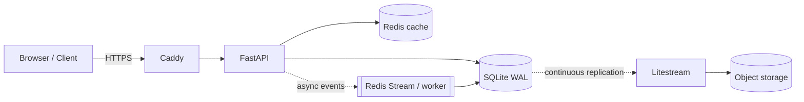

# System Design

## 1. Goals

- Fast, reliable redirects on a single-node deployment.
- Durable link creation with simple operations.
- Analytics decoupled from the redirect path.
- A clear, documented evolution path to Tier 2 (100×).

Non-goals for v1: high availability, multi-region, real-time analytics, custom domains.

## 2. Architecture (Tier 1)

| Component | Responsibility |
| --- | --- |
| Caddy | TLS, HTTP/2-3, compression, security headers, reverse proxy |
| FastAPI | Validation, auth, create/read/delete, redirect, stats |
| Redis | Cache-aside, negative cache, rate-limit counters, event stream |
| SQLite | Source of truth for links, keys, and analytics rollups |
| Litestream | Continuous WAL replication to S3-compatible storage |
| Worker | Consumes click events, batches inserts and rollups |

SQLite runs on the VPS local SSD inside a Docker volume. There is exactly one writer process at a time from SQLite's perspective; WAL allows concurrent readers.

## 3. Write path

1. Authenticate API key; apply rate limit.
2. Validate scheme, host, length, and alias syntax.
3. Generate a random 7-char base62 code (or accept a custom alias).
4. `INSERT` into `links` inside a short transaction.
5. On `UNIQUE` conflict: retry generation up to 5 times; custom aliases return `409`.
6. Return `201` with the short URL and expiry.

SQLite settings: `journal_mode=WAL`, `synchronous=NORMAL`, `busy_timeout=5000`, `foreign_keys=ON`. Never hold a transaction across network I/O.

## 4. Redirect path

1. Normalize `code`; reject invalid shapes early.
2. Read `link:{code}` from Redis.
3. On miss: `SELECT` from SQLite, then populate cache (single-flight).
4. Missing → `404`; expired/deleted/blocked → `410`.
5. Publish a click event (non-blocking) and return `302` with `Location`.

The redirect path never waits on analytics and never writes to SQLite in v1.

## 5. Key generation

7 base62 characters → `62^7 ≈ 3.5 trillion` codes.

| Strategy | Pros | Cons | Status |
| --- | --- | --- | --- |
| DB sequence → base62 | No collisions, simple | Enumerable, couples writes to primary | Rejected |
| Random 7-char + unique index retry | No coordination, unguessable, even distribution | Rare retries | **Chosen** |
| Hash(long URL) | Deterministic dedupe | Collisions, no clean expiry/alias semantics | Rejected |
| Snowflake / range allocator | Sortable, shard-friendly | Extra component; overkill at Tier 1 | Tier 2 option |

Collision math at Tier 1 (1M links): expected colliding pairs `N²/(2·62^7) ≈ 0.14` total over the whole dataset. At Tier 2 (100M links): ~1,400 total, i.e. ~1.4×10⁻⁵ per insert. Regeneration is cheaper than coordination.

## 6. Redirect semantics and caching

Use `302 Found` with `Cache-Control: no-store` in v1:

- `301` is cached indefinitely by browsers, breaking expiry, deletion, and analytics.
- `302` keeps the client coming back, so the server can enforce state.

In Phase 3, allow opt-in `Cache-Control: public, max-age=60, s-maxage=300` for links marked cacheable. Keep `302` so clients revalidate.

## 7. Cache design

- Pattern: cache-aside with key `link:{code}` and value `{long_url, status, expires_at}`.
- TTL: 1 hour + random jitter.
- Negative cache: `link:miss:{code}` for 30–60s to absorb scans.
- Invalidation: delete on deactivate; expiry is checked on every read, so stale entries cannot extend a link's life.
- Stampede protection: per-key single-flight and a cap on concurrent fills.
- Redis is disposable: disable persistence; on restart, the cache warms from SQLite.

At Tier 1 the full 30-day link set is only a few hundred MB, so Redis can hold nearly everything hot.

## 8. Analytics

- Redirect appends `{code, ts, ip_hash, ua, referrer, country}` to a Redis Stream (bounded) with an in-process buffer fallback.
- A worker batches events into `clicks` (raw, ≤7 days), updates `link_daily_stats`, and increments per-referrer daily counters.
- Rollups are idempotent (`INSERT ... ON CONFLICT ... DO UPDATE`), so replays are safe.
- Unique visitors use HyperLogLog (~2% error).
- If volume grows, add sampling and move raw events to a columnar store (Tier 2).

## 9. Expiry and deletion

- Lazy enforcement on read (`expires_at <= now` → `410`).
- Hourly cleanup job deletes expired/deleted links in small batches, then old raw clicks.
- SQLite `DELETE` + `PRAGMA incremental_vacuum` avoids full `VACUUM` locks.
- Cache entries are deleted on deactivation; expiry needs no invalidation.
- Codes are not reused immediately; keep a 30-day tombstone.

## 10. Scaling path

| Stage | Change | Trigger |
| --- | --- | --- |
| 1 | Single VPS, SQLite WAL, Redis, Caddy | v1 |
| 2 | Managed Postgres; app on 2+ nodes behind a load balancer | Writes >50/s, DB >20GB, or HA required |
| 3 | Read replicas + Redis cluster | Read p99 or primary CPU SLO breach |
| 4 | Shard Postgres by `hash(code)` | Single-primary write/dataset limit |
| 5 | Edge/CDN redirects, multi-region | Global latency or regulatory requirement |

SQLite is deliberately stage 1 only. Keep SQL portable (SQLAlchemy, no SQLite-only SQL in the domain layer) so the Postgres move stays mechanical.

Sharding notes (Tier 2 exercise):

- `hash(code)` distributes evenly and maps a redirect to one shard.
- Hot keys still concentrate reads; use local cache, coalescing, and per-key limits.
- Cross-shard listing/stats require scatter-gather or a separate analytics store.

## 11. Failure modes

| Failure | Impact | Mitigation |
| --- | --- | --- |
| SQLite locked | Write latency spikes | `busy_timeout`, short transactions, single hot writer path |
| Disk full | Writes fail, WAL cannot checkpoint | Alerts at 80%, log rotation, volume resize runbook |
| Redis down | Latency spike | Circuit breaker → SQLite fallback; cache warms automatically |
| Litestream lag | Higher RPO | Alert if replication lag >60s; nightly snapshots |
| VPS loss | Full outage | Restore from object storage on a new host (RTO <30min) |
| Bad deploy | Errors/outage | Health checks, previous image tag, backward-compatible migrations |
| Hot link | CPU/Redis hotspot | Single-flight, local TTL cache, per-IP limits |
| Queue unavailable | Lost analytics | Bounded buffer + drop counter; redirects unaffected |

## 12. Security and abuse

- Only `http`/`https`; reject private IPs for any URL-preview feature (SSRF).
- Domain blocklist for phishing/malware; asynchronous scan; disable on match.
- Salted IP hashes only; no raw IPs in logs or storage.
- Per-API-key and per-IP rate limits at the app layer (Redis token bucket).
- Reserved aliases: `api`, `admin`, `health`, `healthz`, `readyz`, `static`, `assets`.
- Caddy adds HSTS and security headers; containers run non-root.

## 13. Key tradeoffs

| Decision | Choice | Why |
| --- | --- | --- |
| SQLite vs Postgres | SQLite for Tier 1 | Simple ops, fast reads, adequate writes; documented migration path |
| 301 vs 302 | 302 + no-store | Correct expiry/deletion/analytics |
| Random vs counter codes | Random | No coordination, unguessable, negligible retries |
| Sync vs async analytics | Async | Keeps redirect p99 low |
| Single VPS vs managed platform | VPS + Compose | Learning ops fundamentals; low cost; easy to reason about |
| Raw clicks vs rollups | Rollups + short raw retention | Keeps SQLite small and queries fast |
